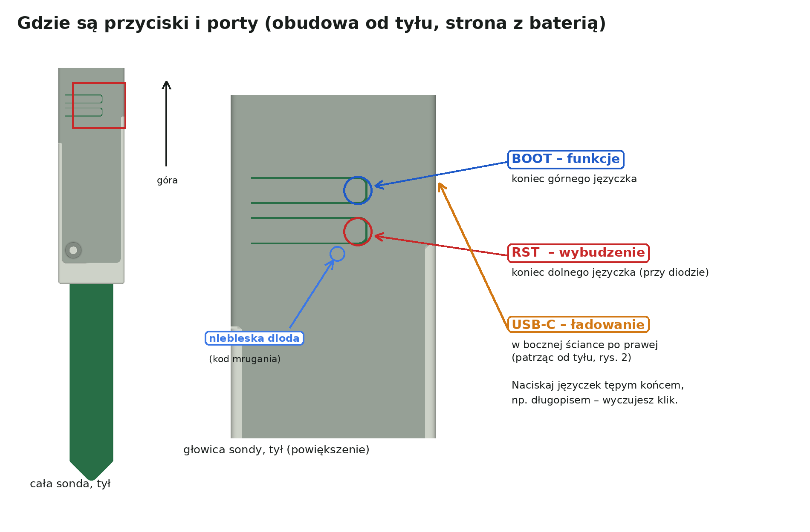
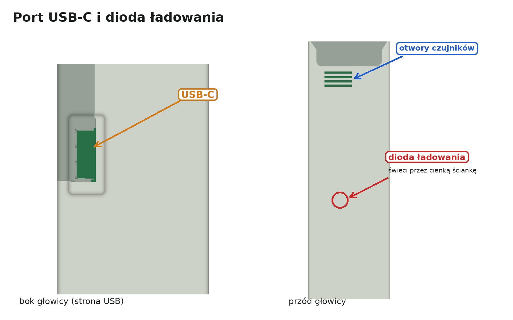

# Czujnik roślin – instrukcja obsługi

Filip Kutt · listopad 2026

Sonda mierzy wilgotność gleby co godzinę i zapisuje pomiary w swojej pamięci. Dane oglądasz w aplikacji na telefonie: **przez bazę** (druga płytka stale podłączona do ładowarki USB – dane są zawsze dostępne, bez naciskania przycisków) albo **bezpośrednio z sondy** po naciśnięciu RST. Do pracy nie potrzeba WiFi ani serwera.

## W skrócie

1. Naładuj sondę przez USB-C, aż zgaśnie dioda ładowania (na przodzie obudowy).
2. Na telefonie otwórz stronę aplikacji i zainstaluj ją na ekranie głównym (rozdział „Aplikacja na telefon”).
3. **Z bazą:** podłącz bazę do ładowarki USB i naciśnij **RST** z tyłu sondy. Po kodzie wilgotności dioda zaświeci na 1 s – sonda znalazła bazę. W aplikacji naciśnij **Połącz z bazą** i wybierz `plant-hub-xxxxxx` (tylko za pierwszym razem, później aplikacja łączy się sama).
4. **Bez bazy:** naciśnij **RST** (Bluetooth sondy działa 2 minuty), w aplikacji otwórz **Ustawienia → Sonda bez bazy → Połącz z sondą** i wybierz `plant-sensor-xxxxxx`.
5. Nad wykresem naciśnij **✎** i wpisz nazwę rośliny, np. „Bazylia na oknie”.
6. Wbij sondę w ziemię do linii na płytce. Z bazą pomiary spływają same; bez bazy co tydzień powtarzaj krok 4.

## Przyciski, dioda i port USB-C

Oba przyciski są z tyłu obudowy (strona z baterią), pod dwoma wyciętymi języczkami przy górnej krawędzi. Naciskasz koniec języczka tępym przedmiotem, np. długopisem, aż poczujesz klik.

- **RST** – koniec dolnego języczka, tuż przy okienku niebieskiej diody. Budzi sondę.
- **BOOT** – koniec górnego języczka (bliżej górnej krawędzi). Służy do funkcji specjalnych (tryb serwisowy, wyłączenie, reset sieci).
- **Niebieska dioda** – świeci przez okienko tuż pod dolnym języczkiem (RST).
- **USB-C** – w bocznej ściance głowicy, tylko do ładowania (i wgrywania oprogramowania).
- **Dioda ładowania** – na przodzie głowicy, świeci przez cienką ściankę.

Jak rozpoznać RST: po jego naciśnięciu niebieska dioda od razu zaczyna mrugać. Samo krótkie naciśnięcie BOOT, gdy sonda śpi, nic nie robi.

## Co robią przyciski

BOOT działa tylko wtedy, gdy sonda nie śpi: po RST (z bazą przez ok. 10 s, bez bazy przez 2 minuty) albo w trybie serwisowym. Najpierw naciśnij RST, potem przytrzymaj BOOT i puść go po właściwym sygnale diody.

| Co robisz | Sygnał diody | Skutek |
| --- | --- | --- |
| Naciśnij RST | mruganie przez ok. 6 s | Pomiar i wysyłka do bazy. Z bazą: świecenie 1 s, sen po ok. 10 s. Bez bazy: Bluetooth na 2 min (dłużej, gdy telefon jest połączony), potem sen |
| Przytrzymaj BOOT 2 s, puść | dioda gaśnie i mruga raz | Włącza / wyłącza tryb serwisowy |
| Przytrzymaj BOOT 5 s, puść | dwa mrugnięcia | **Wyłączenie** – sonda nie mierzy i prawie nie zużywa baterii. Włączasz ją przez RST (startuje w trybie serwisowym) |
| Przytrzymaj BOOT 10 s | szybkie miganie | **Reset sieci** – kasuje WiFi i MQTT. Kalibracja, ustawienia i pomiary zostają |

**Nigdy nie trzymaj BOOT, naciskając RST.** Sonda wejdzie wtedy w tryb wgrywania oprogramowania i nie będzie mierzyć. Wystarczy wtedy samo naciśnięcie RST.

## Sygnały diod

Podczas zwykłych pomiarów co godzinę dioda nie świeci, żeby oszczędzać baterię.

| Dioda | Co widać | Znaczenie |
| --- | --- | --- |
| Niebieska | wolne mruganie (ok. 0,6 s) | Ziemia sucha |
| Niebieska | szybkie mruganie (poniżej 0,1 s) | Ziemia mokra; im szybciej, tym wilgotniej |
| Niebieska | jedno długie świecenie (1,5 s) przed mruganiem | Bateria słaba (poniżej 3,1 V) – naładuj |
| Niebieska | jedno świecenie (1 s) po mruganiu | Pomiar dotarł do bazy (sonda nie włącza Bluetooth i zaraz zaśnie) |
| Niebieska | 3 szybkie błyski | Tryb serwisowy włączony |
| Niebieska | 2 błyski po przytrzymaniu BOOT | Puść teraz = wyłączenie sondy |
| Niebieska | szybkie miganie po 10 s BOOT | Reset sieci |
| Dioda ładowania (przód) | świeci | Trwa ładowanie; gaśnie, gdy bateria jest pełna |

## Aplikacja na telefon

Aplikacja to strona internetowa, którą instaluje się na ekranie głównym. Po pierwszym otwarciu działa bez internetu, a historia pomiarów zostaje w telefonie. Adres strony dostajesz od osoby, która przygotowała sondę.

**Android (Chrome)**

1. Otwórz adres aplikacji w Chrome.
2. W aplikacji rozwiń **Ustawienia** na dole strony i w karcie **Dane i aplikacja** naciśnij **Zainstaluj aplikację** – albo w menu ⋮ Chrome wybierz **Dodaj do ekranu głównego**.
3. Przy pierwszym połączeniu zezwól na Bluetooth i lokalizację (Android wymaga tego do wyszukiwania urządzeń Bluetooth).

**iPhone**

Safari nie obsługuje Bluetooth na stronach. Zainstaluj z App Store darmową przeglądarkę **Bluefy** i w niej otwórz adres aplikacji.

Komputer z Chrome lub Edge (Windows, macOS) też działa, jeśli ma Bluetooth.

**Wygląd aplikacji**

- **Kafelki czujników** – nazwa, wilgotność w % z paskiem, napięcie baterii i kiedy był ostatni pomiar. Czerwony napis oznacza „naładuj” (bateria poniżej 3,05 V) albo „brak kontaktu” (sonda dawno się nie odezwała). Dotknięcie kafelka wybiera czujnik.
- **Wykres** wybranego czujnika – wilgotność (niebieska linia) i bateria (pomarańczowa) za 24 h, 7 dni, 30 dni albo całość. Dotknięcie napisu „Bateria V” pod wykresem chowa albo pokazuje linię baterii (aplikacja to zapamiętuje). Przycisk **✎** obok nazwy zmienia nazwę czujnika.
- **Stan połączenia** w prawym górnym rogu – zielona kropka i nazwa bazy = połączono. Gdy widać napis „połącz”, dotknij go.
- **Ustawienia** (zwinięte na dole strony) – karty: Połączenie, karta wybranego czujnika, WiFi / MQTT, Dane i aplikacja (kopia, CSV, instalacja, język).

Aplikacja sama łączy się z ostatnio używaną bazą po otwarciu, wraca po utracie zasięgu i co minutę dopisuje nowe pomiary. Przeciągnięcie palcem w dół nie odświeża strony, bo zrywałoby to połączenie Bluetooth.

## Codzienne użycie

**Z bazą:** po prostu otwórz aplikację. Połączy się sama z bazą, dopisze nowe pomiary wszystkich sond i dopóki jest otwarta, co minutę sprawdza, czy są nowe. Na sondach nic nie naciskasz.

**Bez bazy** pomiary pobierasz, kiedy chcesz; sonda pamięta ok. 16 000 pomiarów (prawie 2 lata przy pomiarze co godzinę). Połącz się przynajmniej raz w tygodniu, bo wtedy telefon ustawia też zegar sondy.

1. Naciśnij **RST** na sondzie.
2. W ciągu 2 minut w aplikacji otwórz **Ustawienia → Sonda bez bazy → Połącz z sondą** i wybierz sondę z listy.
3. Cienki pasek pod nagłówkiem pokazuje pobieranie. Potem na kafelku i wykresie widzisz wilgotność, baterię i historię.
4. Naciśnij **Rozłącz** (Ustawienia → Połączenie) albo po prostu zamknij aplikację. Sonda sama zasypia.

**Ustawienia czujnika** – w Ustawieniach na dole strony, w karcie z nazwą wybranego czujnika. Z bazą możesz zmienić „Pomiar co” i kalibrację w każdej chwili (sonda przyjmie zmianę przy następnym pomiarze, do tego czasu przy nazwie widać ⏳). Bez bazy wszystkie ustawienia są dostępne tylko podczas połączenia z sondą:

| Ustawienie | Domyślnie | Uwagi |
| --- | --- | --- |
| Pomiar co (min) | 60 | 10–360. Częściej = krótsza praca na baterii |
| Wysyłka do MQTT co (pomiarów) | 6 | Tylko sonda bez bazy z własnym WiFi; z bazą do Home Assistant wysyła baza |
| Limit trybu serwisowego (min) | 30 | Po tym czasie sonda sama wraca do pracy |

**Nazwy czujników:** wybierz kafelek i naciśnij **✎** obok nazwy nad wykresem. Wpisz np. roślinę i miejsce (do 19 znaków); puste pole przywraca nazwę sondy. Przy połączeniu z bazą nazwa zapisuje się w bazie, więc widzą ją też inne telefony i Home Assistant. Zmieniona bez połączenia trafi do bazy przy następnym połączeniu.

Każdy czujnik ma w telefonie własną historię, także gdy nie ma połączenia. Przypomnienie o kopii zapasowej i ostrzeżenie o pamięci przeglądarki są w Ustawieniach, w karcie Dane i aplikacja.

## Pierwsze uruchomienie i praca bez WiFi

Nowa sonda albo sonda po resecie sieci startuje w trybie serwisowym (3 szybkie błyski). Tworzy wtedy własną sieć WiFi `plant-sensor-xxxxxx` (hasło `plantsensor`), a Bluetooth jest wyłączony.

**Tylko z telefonem (bez WiFi):**

1. Naciśnij RST, a potem przytrzymaj BOOT 2 s i puść po jednym mrugnięciu. Sonda przechodzi do normalnej pracy. Jeśli nic nie zrobisz, przejdzie sama po 30 minutach.
2. Naciśnij RST jeszcze raz. Jeśli masz bazę, sonda ją znajdzie (po kodzie dioda świeci 1 s) – połącz się z bazą. Bez bazy w ciągu 2 minut otwórz w aplikacji Ustawienia → Sonda bez bazy → Połącz z sondą. Od teraz sonda tylko mierzy i zapisuje, nie próbuje łączyć się z WiFi.

**Z Home Assistant (opcjonalnie):** jeśli masz bazę, WiFi i MQTT ustawiasz **tylko w bazie** (Ustawienia → karta WiFi / MQTT podczas połączenia z bazą) – sondy nie potrzebują WiFi. Bez bazy: w trybie serwisowym połącz telefon z siecią sondy, otwórz http://192.168.4.1 i wybierz swoją sieć WiFi; broker MQTT ustawiasz potem na stronie sondy albo w aplikacji (karta WiFi / MQTT podczas połączenia z sondą).

## Kalibracja

Kalibracja ustala, jaki odczyt to 0 % (sucho), a jaki 100 % (mokro). Zostaje po resecie sieci, więc robisz ją raz dla danej ziemi.

**Z bazą:**

1. Wbij sondę do linii na płytce w **suchą** ziemię z doniczki, w której będzie pracować, i naciśnij RST (sonda od razu zmierzy i wyśle pomiar).
2. Gdy na kafelku zobaczysz „przed chwilą”, otwórz Ustawienia → karta czujnika → **Sucho = ostatni odczyt**.
3. Podlej obficie, odczekaj ok. 10 minut, aż woda wsiąknie, i znowu naciśnij RST.
4. Po nowym pomiarze naciśnij **Mokro = ostatni odczyt**. Sonda przyjmie kalibrację przy następnym pomiarze (⏳ zniknie).

**Bez bazy:**

1. Wbij sondę w suchą ziemię, naciśnij RST i połącz się z sondą.
2. W Ustawieniach, w karcie sondy, naciśnij **Zmierz teraz**, a potem **Ustaw sucho**.
3. Podlej obficie i odczekaj ok. 10 minut.
4. Naciśnij RST, połącz się, naciśnij **Zmierz teraz**, a potem **Ustaw mokro**.

**Ręcznie:** jeśli znasz wartości (np. z innej sondy w tej samej ziemi), wpisz je w polach **Sucho (V)** i **Mokro (V)** w karcie czujnika (z bazą) albo w karcie sondy (bez bazy) i naciśnij **Zapisz kalibrację**. Można użyć przecinka albo kropki. Sucho musi być wyższe niż mokro; fabryczne wartości to 2,30 V (sucho) i 1,30 V (mokro). Aktualny odczyt w V widać w tej samej karcie („odczyt”), co pomaga dobrać wartości.

Wynik zależy od docisku ziemi wokół sondy. Wbijaj ją zawsze tak samo głęboko i dociskaj ziemię wokół, bez szczelin powietrza. Nawozy i sól zawyżają odczyt.

## Ładowanie baterii

Sonda ma ogniwo LiFePO4 14500 (3,2 V). Przy pomiarze co godzinę bez WiFi bateria wystarcza na wiele miesięcy.

- Ładuj zwykłą ładowarką USB-C (5 V) przez port w boku obudowy. Dioda ładowania na przodzie świeci podczas ładowania i gaśnie, gdy bateria jest pełna.
- Ładuj, gdy aplikacja pokazuje poniżej 3,05 V albo gdy po RST dioda najpierw świeci długo (1,5 s).
- Poniżej 3,0 V sonda sama mierzy rzadziej (co 6 godzin), żeby nie rozładować ogniwa do zera.
- **Wymieniaj tylko na ogniwo LiFePO4 14500.** Zwykłe ogniwo Li-ion 14500 (3,7 V) uszkodzi elektronikę.
- Wymiana baterii kasuje zegar sondy. Pomiary zostają, a czas ustawi baza przy następnym pomiarze albo telefon przy połączeniu.

## Kopia zapasowa i przekazanie sondy

Historia w telefonie jest zapisana w aplikacji. Odinstalowanie aplikacji albo wyczyszczenie danych przeglądarki ją kasuje, dlatego raz w miesiącu zrób kopię.

- **Kopia:** w Ustawieniach → Dane i aplikacja naciśnij **Zapisz kopię**. Telefon zaproponuje miejsce zapisu (np. Dysk Google, poczta). Kopia obejmuje wszystkie czujniki razem z nazwami.
- **Przywracanie:** **Przywróć z kopii** i wybierz plik `plant-sensor-backup-….json`. Pomiary z kopii są dołączane, nic nie jest kasowane.
- **Eksport CSV:** w Ustawieniach → Dane i aplikacja, dla wybranego czujnika; plik otworzysz w Excelu.

**Przekazanie sondy innej osobie:**

1. Wyczyść historię w sondzie. **Z bazą:** Ustawienia → karta czujnika → Więcej → **Wyczyść historię w sondzie**, poczekaj na następny pomiar (⏳ zniknie), potem **Usuń z bazy**. **Bez bazy:** połącz się z sondą i w karcie sondy → Więcej naciśnij **Wyczyść historię w sondzie**.
2. Jeśli sonda miała Twoje WiFi: naciśnij RST i przytrzymaj BOOT 10 s (reset sieci).
3. Na czas przewozu wyłącz sondę: RST, potem BOOT 5 s, puść po dwóch mrugnięciach.
4. Nowy właściciel naciska RST, przytrzymuje BOOT 2 s (wyjście z trybu serwisowego) i znowu RST. Jeśli ma własną bazę, sonda sama ją znajdzie (czasem dopiero po 3–4 naciśnięciach RST, bo najpierw szuka starej bazy). Bez bazy łączy się przez Ustawienia → Sonda bez bazy. Kalibracja zostaje.

## Baza – automatyczne zbieranie pomiarów (opcjonalnie)

Baza to druga płytka ESP32-C3 (np. SuperMini) podłączona na stałe do ładowarki USB. Sonda przy każdym pomiarze sama wysyła do niej nowe odczyty przez radio ESP-NOW – bez routera, trwa to ułamek sekundy. Telefon łączy się z bazą przez Bluetooth w dowolnej chwili, więc **nie trzeba już naciskać RST**, żeby pobrać dane. Wymaga firmware sondy **0.9.10** lub nowszego.

**Uruchomienie bazy**

1. Wgraj do płytki plik `plant_hub.yaml` (tak samo jak sondę, przez USB).
2. Po pierwszym włączeniu baza tworzy sieć `plant-hub-xxxxxx` (hasło `planthub`). Połącz się z nią telefonem i wybierz swoją sieć WiFi – albo pomiń ten krok: bez WiFi baza działa offline, tylko przez Bluetooth.
3. Postaw bazę w miejscu, gdzie zasięg obejmuje wszystkie sondy (jak zasięg WiFi 2,4 GHz – zwykle kilka pokoi).

**Parowanie sond** jest automatyczne. Przełącznik „Wysyłka do bazy (ESP-NOW)” w sondzie jest domyślnie włączony; sonda bez bazy szuka jej po naciśnięciu RST i co szósty pomiar, a gdy baza przestanie odpowiadać – szuka jej ponownie. Pomiary, których nie udało się wysłać (baza wyłączona, poza zasięgiem), czekają w sondzie i zostaną dosłane później. Sonda pobiera też z bazy aktualny czas.

**Sonda z bazą nie używa WiFi ani Bluetooth.** Gdy baza odpowiada, sonda tylko mierzy, wysyła do bazy i zasypia – z telefonem i z Home Assistant rozmawia baza. Po naciśnięciu RST sonda mruga kodem wilgotności, potem **świecenie przez 1 s = pomiar dotarł do bazy**, a po ok. 10 s zasypia. Jeśli baza nie odpowie (wyłączona, za daleko), sonda zachowuje się jak bez bazy: Bluetooth na 2 minuty i WiFi, jeśli było ustawione. Do konfiguracji lub naprawy sondy zawsze działa tryb serwisowy: po RST przytrzymaj BOOT 2 s.

**Telefon z bazą:** za pierwszym razem naciśnij w aplikacji **Połącz z bazą** i wybierz `plant-hub-xxxxxx`. Na kafelkach zobaczysz wszystkie sondy, które zgłosiły się do bazy. Aplikacja pobiera tylko nowe pomiary i dopisuje je do historii każdego czujnika. Informacje o bazie (liczba sond, pomiarów, stan WiFi i MQTT) są w Ustawieniach, w karcie Połączenie.

Strona sama łączy się z ostatnio używaną bazą (także po odświeżeniu), wraca po utracie połączenia i co minutę dopisuje nowe pomiary. Na ekranie są tylko kafelki czujników (wilgotność, bateria, ostatni kontakt) i wykres wybranego czujnika; połączenie, ustawienia sond, WiFi/MQTT bazy i kopia zapasowa są w zwiniętych **Ustawieniach** na dole strony. Czerwony napis na kafelku oznacza słabą baterię albo dłuższy brak kontaktu z sondą.

**Zmiana ustawień przez bazę:** wybierz kafelek czujnika i rozwiń Ustawienia. Karta z nazwą czujnika ma **Pomiar co (min)**, kalibrację (**Sucho / Mokro = ostatni odczyt**) i w „Więcej”: anulowanie oczekujących zmian, czyszczenie historii w sondzie i usunięcie sondy z bazy. Nazwę zmieniasz przyciskiem ✎ nad wykresem. Zmiany zapisują się w bazie (⏳ przy nazwie = czekają) i sonda przyjmuje je przy **następnym pomiarze** – najpóźniej po ustawionym interwale albo od razu po naciśnięciu RST na sondzie.

**Home Assistant:** jeśli baza ma WiFi i MQTT, publikuje odczyty wszystkich sond w HA – sondy nie muszą wtedy łączyć się z WiFi wcale, co oszczędza baterię.

**Pamięć bazy:** ok. 28 tysięcy pomiarów (np. 5 sond co godzinę ≈ 8 miesięcy; potem najstarsze są nadpisywane). Odłączenie zasilania **nie kasuje** historii ani listy sond. Przytrzymanie BOOT na bazie przez 10 s kasuje tylko jej ustawienia WiFi/MQTT. Dioda bazy mignie przy każdym odebranym pomiarze.

## Rozwiązywanie problemów

| Objaw | Co zrobić |
| --- | --- |
| Po RST dioda nie mruga | Naładuj baterię. Jeśli dalej nic, naciśnij RST jeszcze raz; sonda mogła być wyłączona (BOOT 5 s) |
| Aplikacja nie widzi sondy | Bez bazy: naciśnij RST tuż przed „Połącz z sondą” (Bluetooth działa 2 min). Sonda, która widzi bazę, nie włącza Bluetooth – połącz się z bazą. Na Androidzie włącz Bluetooth i lokalizację |
| Na kafelku „brak kontaktu” | Naciśnij RST na tej sondzie. Jeśli po kodzie wilgotności nie ma świecenia 1 s, sonda nie dosięga bazy: przestaw bazę bliżej albo naładuj sondę. Niewysłane pomiary zostaną dosłane |
| Aplikacja nie łączy się sama z bazą po otwarciu | Dotknij napisu „połącz” w prawym górnym rogu. Żeby łączyła się sama, w Chrome wpisz chrome://flags/#enable-web-bluetooth-new-permissions-backend, ustaw Enabled i uruchom Chrome ponownie |
| Ustawienie z ⏳ nie przechodzi do sondy | Sonda odbiera zmiany przy następnym pomiarze; naciśnij na niej RST, żeby przyspieszyć |
| „Ta przeglądarka nie obsługuje Web Bluetooth” | Android: użyj Chrome. iPhone: użyj Bluefy |
| Sonda nie znika z trybu serwisowego (3 błyski po RST) | Przytrzymaj BOOT 2 s albo poczekaj 30 min |
| Brak nowych pomiarów mimo połączenia | Połącz się z sondą bezpośrednio, sprawdź w Ustawieniach → karta sondy → Diagnostyka historię uruchomień i przekaż ją osobie, która przygotowała sondę |
| Wilgotność stale 0 % lub 100 % | Zrób kalibrację; sprawdź, czy sonda jest wbita do linii |
| Daty pomiarów się nie zgadzają | Połącz się z bazą albo z sondą – zegar sondy ustawia baza lub telefon |
| Sonda nie budzi się po wgraniu oprogramowania przez USB | Naciśnij RST (bez BOOT) |

## Dane techniczne

| Parametr | Wartość |
| --- | --- |
| Pomiar | pojemnościowy, ścieżka na płytce, sygnał ok. 1 MHz |
| Moduł | ESP32-C3 SuperMini (WiFi, Bluetooth LE) |
| Bateria | LiFePO4 14500, ładowanie USB-C 5 V |
| Pamięć pomiarów | 16 384 pomiary (ok. 22 miesiące co godzinę) |
| Interwał pomiaru | 10–360 min, domyślnie 60 |
| Bluetooth po RST | bez bazy 2 min (dłużej przy połączonym telefonie); z bazą wyłączony |
| Łączność z bazą | ESP-NOW 2,4 GHz, zasięg jak WiFi (zwykle kilka pokoi), ok. 0,2 s radia na pomiar |
| Pamięć bazy | 28 672 pomiary, do 24 sond; zostaje po odłączeniu zasilania |
| Oprogramowanie | 0.9.11 alpha (ESPHome); baza 0.1.1 alpha |
| Obudowa | głowica nie jest wodoszczelna – nie zalewaj jej, wbijaj sondę tylko do linii |
